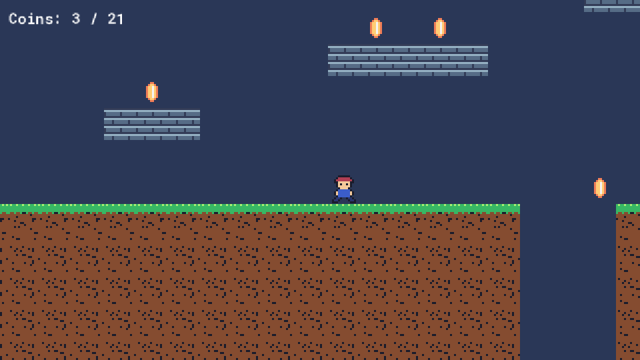
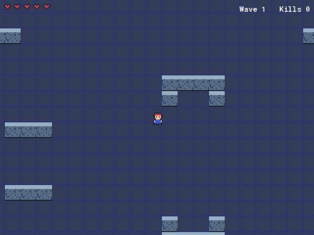

# GameMaker Expert Kit

**An agent skill and MCP server that helps AI coding assistants work well with GameMaker (LTS 2024 / 2026).**
Works with Claude Code, Claude Desktop, GitHub Copilot (agent mode), Cursor, Windsurf and any MCP client.

AI assistants learned GameMaker from a decade of tutorials, many of them outdated. They call functions that were
removed years ago (these still compile, then crash), treat `health` as if it belonged to one object, follow the
player with the camera in the wrong event, and hand-write `.yy` files that the IDE refuses to open.

This kit gives the assistant up-to-date knowledge of the engine and a validator that checks a project the way
the IDE and the compiler will.

## What's inside

| Part | What it does |
| :--- | :--- |
| [`SKILL.md`](SKILL.md) | Workflow, the GML rules that prevent the most common bugs, and a troubleshooting table |
| [`references/`](references/) | 9 manuals: events and frame order, pitfalls, scripts and functions, architecture, tilemaps and collisions, cameras, audio, project format, command-line builds |
| `gm_validate_project` | Checks broken references between assets, missing or orphaned files, fields the compiler requires, room order, and GML pitfalls (built-in globals, double movement, removed functions) |
| `gm_read_project` / `gm_read_script` | Asset catalog by type, room order, IDE version, script source |
| `gm_inspect_assets` | Facts about an art pack: image sizes, filmstrip frame counts, tile grids, name-based tags, to plan a game from what you have |

## How the knowledge is checked

The references are written against the engine itself, not from memory:

- Behaviour the docs describe (event order, built-in globals, built-in motion, reference semantics for arrays and
  structs, string and number formatting, `self`/`other` scoping) was measured on GameMaker runtime 2026.0.0.23.
- Every GML snippet in the docs is compiled with GameMaker's own compiler, and every function it calls is checked
  against the runtime's API specification.
- The validator's project-structure rules each come from an error that was reproduced (the message the IDE or the
  compiler shows and its cause), and each has a test that keeps it working.

## Install

Requires Python 3.9+ and Pillow: `pip install -r requirements.txt`.

**1. Skill:** copy this folder into your assistant's skills directory.

| Assistant | Location |
| :--- | :--- |
| Claude Code | `~/.claude/skills/gamemaker-expert/` (or `.claude/skills/gamemaker-expert/` in a project) |
| GitHub Copilot | `.github/skills/gamemaker-expert/` |
| Other agents | wherever they load `SKILL.md` skills from |

**2. MCP server:** register `mcp/server.py` (see `mcp/mcp.json`).

```json
{
  "mcpServers": {
    "gamemaker": { "command": "python", "args": ["<path-to-kit>/mcp/server.py"] }
  }
}
```

- Claude Code: `claude mcp add gamemaker -- python <path-to-kit>/mcp/server.py`
- Claude Desktop: `%APPDATA%\Claude\claude_desktop_config.json`
- VS Code / Copilot: `.vscode/mcp.json` (`"servers"` instead of `"mcpServers"`)
- Cursor / Windsurf: `.cursor/mcp.json` or global settings

Set `GM_MCP_LOG=<file>` to log tool calls.

## Command line

The same checks work without an assistant:

```bash
python scripts/gm_project.py "C:/Games/MyGame"          # catalog and room order
python scripts/gm_lint.py "C:/Games/MyGame"             # validate (exit code 1 on errors)
python scripts/gm_asset_inspector.py "C:/Art/Dungeon"   # art pack facts
```

## Development

```bash
pip install -r requirements-dev.txt
python -m pytest              # validator, protocol and helper tests; no GameMaker needed
python tools/check_pii.py     # no machine paths or personal data in tracked files
```

CI runs the tests on Ubuntu and Windows with Python 3.9 and 3.12. The tests use a small committed project in
`tests/fixtures/` and mutate copies of it, one known failure at a time.

Bug reports are welcome: an issue with the validator output and the GameMaker version helps the most. If the IDE or
the compiler rejects a project that `gm_validate_project` accepted, that is a bug worth reporting.

## License

MIT (see `LICENSE`). GameMaker is a trademark of YoYo Games Ltd. This project is not affiliated with or endorsed
by YoYo Games.

---

## GameMaker Expert Kit Pro

Everything above is complete on its own. If you also want the assistant to build projects and test them, there is
an extended version with:

- **Project building:** new projects, sprites sliced from sheets, tilesets, rooms with painted tile layers, objects
  with events, parents and collisions, scripts. Everything it generates is tested by compiling and running it
  with GameMaker.
- **Runtime API check:** every GML call checked against the API of your installed GameMaker, to catch functions that
  don't exist before the game reaches them.
- **Headless builds:** compile and run through Igor with automatic setup, and get compile and runtime errors back
  with the object, event and line.
- **Two playable templates:** a platformer and a top-down action game, played automatically in its test suite.

| Platformer template | Top-down template |
| :---: | :---: |
|  |  |

It is available on [Agensi](https://www.agensi.io).
